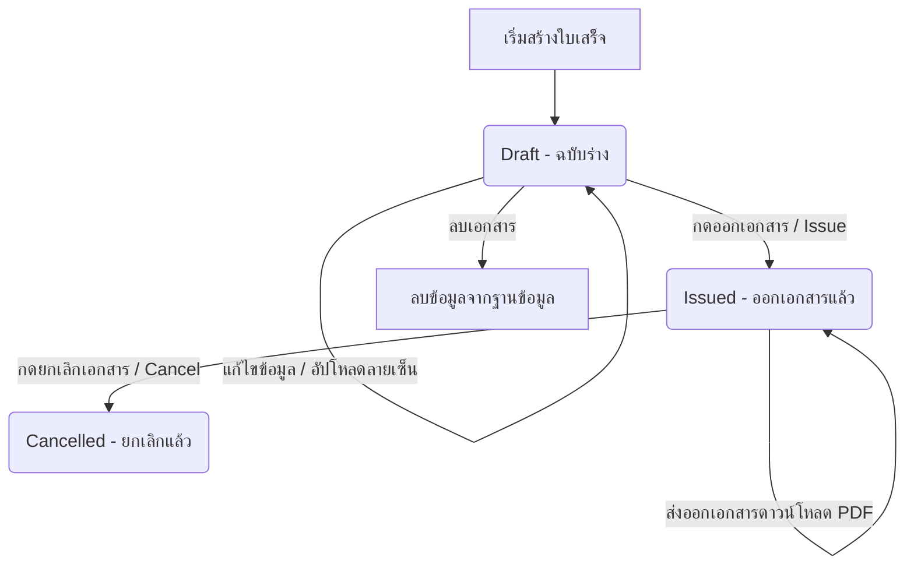
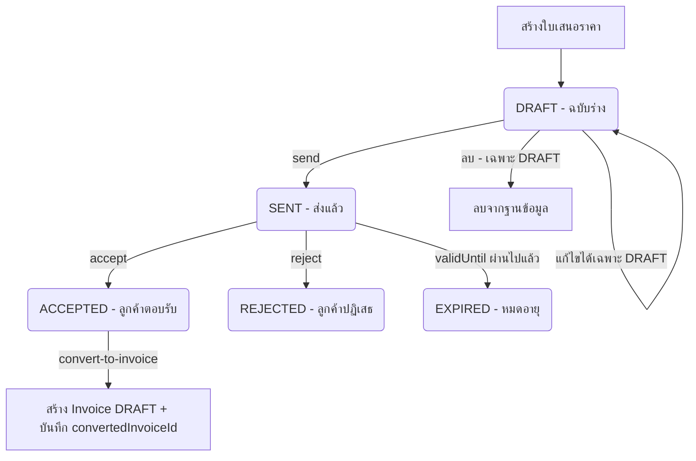

# BoBill Project - สถาปัตยกรรมและการทำงานของระบบ (System Architecture & Specifications)

เอกสารฉบับนี้อธิบายภาพรวมสถาปัตยกรรมของระบบ **BoBill** ข้อมูลโครงสร้างโฟลเดอร์/ไฟล์, ลำดับการทำงาน (Workflows), รายละเอียด API Endpoints และฟังก์ชันการทำงานที่สำคัญในแต่ละโมดูล เพื่อใช้เป็นมาตรฐานอ้างอิงในการพัฒนาและปรับปรุงระบบต่อไป

---

## 1. ผังโครงสร้างโฟลเดอร์ (Directory Structure & File Layout)

### 🔹 Backend Structure (`backend/`)
```text
backend/
├── prisma/
│   ├── schema.prisma         # กำหนดโมดูลฐานข้อมูล (Prisma Schema: User, Invoice, InvoiceItem, EmployeeCard)
│   └── migrations/           # ประวัติเวอร์ชันและการปรับเปลี่ยนฐานข้อมูล SQL
├── src/
│   ├── app.ts                # ไฟล์หลักในการเริ่มต้น Express.js และเรียกใช้โมดูลต่าง ๆ
│   ├── config/               # ค่ากำหนดระบบหลัก (เช่น prisma.ts, environment variables)
│   ├── generated/            # โฟลเดอร์เก็บ Prisma Client Types ที่สร้างขึ้นหลังการทำ migration
│   ├── types/                # TypeScript global type extensions (เช่น express.d.ts สำหรับ req.user)
│   ├── upload/               # โฟลเดอร์ที่เก็บไฟล์ลายเซ็นรูปภาพและรูปพนักงาน
│   └── modules/              # แยกส่วนโมดูลฟังก์ชันย่อยการทำงานแบบโมดูลาร์:
│       ├── auth/             # การลงทะเบียนและเข้าใช้งานระบบ (auth.controller, auth.service, auth.routes)
│       │                     # รวมถึง auth.middleware.ts สำหรับ requireAuth Express middleware
│       ├── users/            # การจัดการและแก้ไขข้อมูลบัญชีผู้ใช้ (user.controller, user.service, user.routes)
│       ├── uploads/          # บริการจัดการการอัปโหลดไฟล์ (upload.routes)
│       ├── invoices/         # ระบบการจัดการเอกสารใบเสร็จ/ใบกำกับภาษี (controller, service, routes, pdf)
│       ├── employee-cards/   # ระบบการจัดการบัตรพนักงาน (controller, service, routes, pdf, validation, types)
│       └── backup/           # ระบบ Backup & Restore & Clean Data (controller, service, routes) — Admin only
└── package.json              # กำหนด Node.js dependencies, ESM "type": "module"
```

### 🔹 Frontend Structure (`frontend/`)
```text
frontend/
├── middleware.ts             # Next.js Route Guard — ตรวจสอบ Session Token (signature + expiry)
│                             # Redirect ไป /login หากไม่ authenticated หรือ token หมดอายุ
├── app/                      # Next.js App Router Pages & API Routes
│   ├── api/                  # API Proxy Routes ทำหน้าที่เชื่อมต่อและยืนยันตัวตนกับ Backend
│   │   ├── auth/             # จัดการ Login / Register (เรียก backend api)
│   │   ├── users/            # Proxy จัดการข้อมูล User
│   │   ├── uploads/          # Proxy จัดการการอัปโหลดไฟล์ลายเซ็นและรูปพนักงาน
│   │   ├── invoices/         # Proxy จัดการใบเสร็จ, สถิติ, และดาวน์โหลด PDF
│   │   └── employee-cards/   # Proxy จัดการบัตรพนักงาน
│   ├── invoices/             # หน้าการทำงานฝั่ง User UI (รายการ, สร้าง, แก้ไข, ดูรายละเอียด)
│   │   ├── page.tsx          # หน้ารายการใบแจ้งหนี้หลัก (Invoice List)
│   │   ├── new/              # หน้าสร้างใบแจ้งหนี้ใหม่
│   │   └── [id]/             # โฟลเดอร์จัดการใบแจ้งหนี้แบบระบุ ID
│   │       ├── page.tsx      # หน้าฟอร์มสำหรับแก้ไขใบแจ้งหนี้ (Edit Form)
│   │       └── view/         # หน้าแสดงรายละเอียดของใบแจ้งหนี้ (View Details)
│   ├── employee-cards/       # หน้าการทำงานฝั่งบัตรพนักงาน UI
│   │   ├── page.tsx          # หน้ารายการบัตรพนักงาน (Employee Card List)
│   │   ├── new/              # หน้าสร้างบัตรพนักงานใหม่
│   │   ├── card-editor-form.tsx # คอมโพเนนต์ฟอร์มกรอกข้อมูลพนักงานและ Live Preview
│   │   └── [id]/             # โฟลเดอร์จัดการบัตรพนักงานแบบระบุ ID (แก้ไขบัตรพนักงาน)
│   ├── backup/               # หน้า Backup & Restore & Clean Data (Admin only)
│   │   ├── page.tsx          # Server Component — ตรวจสอบ Admin role ก่อน render
│   │   └── backup-client.tsx # Client Component — Interactive UI ทั้งหมด
│   ├── login/                # หน้าลงชื่อเข้าใช้งานระบบ
│   ├── signup/               # หน้าสมัครสมาชิกใหม่
│   ├── layout.tsx            # โครงสร้าง Layout หลัก
│   └── page.tsx              # หน้าแรก (Dashboard) แสดงแดชบอร์ดสรุปผลและสถิติ
├── components/               # โฟลเดอร์รวบรวม UI Component ย่อยสำหรับใช้ซ้ำ
│   ├── auth/                 # แบบฟอร์มล็อกอิน สมัครสมาชิก
│   ├── dashboard/            # การแสดงสถิติและใบเสร็จล่าสุดในหน้าแรก
│   ├── layout/               # โครงร่างส่วนหัวและ Sidebar ทางซ้าย (main-sidebar)
│   ├── ui/                   # คอมโพเนนต์ส่วนกลางสำหรับใช้ซ้ำ (เช่น pagination.tsx)
│   └── invoices/             # ไอคอน, สถานะ, เมนูกลุ่มการจัดการปุ่มสำหรับใบแจ้งหนี้
├── lib/                      # ฟังก์ชันช่วยเหลือและ API Client SDK
│   ├── backend-proxy.ts      # ยูทิลิตี Proxy — ตรวจสอบ session, ส่ง Token ผ่าน Authorization: Bearer <token>
│   ├── format/               # ฟังก์ชันจัดรูปแบบตัวเลข เงิน และวันที่
│   ├── invoices/             # API Client เรียกฝั่ง Next.js API Routes (api.ts, types.ts)
│   ├── employee-cards/       # API Client บัตรพนักงาน (api.ts, types.ts)
│   └── backup/               # API Client และ TypeScript types สำหรับ Backup module (api.ts, types.ts)
└── package.json              # กำหนด Next.js dependencies, Tailwind v4.x
```

---

## 2. ขั้นตอนการทำงานของระบบ (System Workflows)

### 🔑 Authentication & Authorization Workflow
1. **การลงชื่อเข้าใช้งาน (Login)** หรือ **การสมัครสมาชิก (Signup)** จะเกิดขึ้นที่หน้าจอ UI ของ Next.js
2. ข้อมูลรหัสผ่านจะถูกส่งผ่าน Next.js API Route `/api/auth/login` หรือ `/api/auth/register`
3. Next.js จะส่งข้อมูลผ่านตัวกลาง `proxyBackendJson` ไปยัง Backend Endpoint
4. Backend จะแฮชรหัสผ่านด้วย `bcryptjs` หรือตรวจสอบชื่อผู้ใช้งานกับรหัสผ่านใน PostgreSQL ผ่าน Prisma
5. เมื่อการเข้าสู่ระบบผ่านการอนุมัติ Backend จะตอบกลับเป็น Session Token และสร้างการเก็บรักษา Cookie ของผู้ใช้

### 🛡️ Auth Guard Flow (2 ชั้น)
ระบบป้องกัน 2 ชั้น ทำงานร่วมกันดังนี้:

**ชั้นที่ 1 — Frontend Route Guard (`middleware.ts`)**
- ตรวจสอบ `bobill_session` cookie ด้วย `verifySessionToken` (signature + expiry)
- หากไม่มี session หรือ token หมดอายุ → redirect ไป `/login?next=<pathname>`
- หากมี session valid และพยายามเข้า `/login`, `/signup` → redirect ไป `/`
- ยกเว้นเส้นทาง: `/_next/*`, `/favicon.ico`, `/api/auth/*`

**ชั้นที่ 2 — Backend Auth Middleware (`requireAuth`)**
- ทุก protected route (`/api/invoices`, `/api/employee-cards`, `/api/users`, `/api/uploads`) ต้องผ่าน middleware นี้
- ตรวจสอบ `Authorization: Bearer <token>` header
- ใช้ HMAC-SHA256 signing logic เดียวกับ Frontend เพื่อ decode token
- หาก token ไม่ valid → ตอบ `401 { message: "Unauthorized" }`
- หาก token valid → ต่อ `req.user: { id, username, roles }` ไปยัง handler
- เส้นทาง Public (ไม่ต้อง auth): `/api/auth/*`, `/uploads/*` (static files)

**Transparent Token Proxy (`backend-proxy.ts`)**
- `getSessionToken()` ดึง raw token จาก cookie และตรวจสอบ validity
- `proxyBackendJson`, `proxyBackendPdf`, `proxyBackendBinaryGet` ทุกฟังก์ชัน:
  ส่ง `Authorization: Bearer <token>` header ไปพร้อมกับทุก request ไปยัง Backend โดยอัตโนมัติ

### 📄 Invoice Life-Cycle Workflow
ระบบมีสถานะของใบเสร็จ/ใบแจ้งหนี้ทั้งหมด 3 สถานะ คือ **`DRAFT` (ฉบับร่าง)**, **`ISSUED` (ออกแล้ว)**, และ **`CANCELLED` (ยกเลิก)**



1. **สร้างใบแจ้งหนี้**: เมื่อผู้ใช้สร้างใบแจ้งหนี้ใหม่ ระบบจะบันทึกสถานะเป็น `DRAFT` เป็นค่าเริ่มต้น
2. **ปรับแต่งและแก้ไข**: ใบแจ้งหนี้ที่อยู่ในสถานะ `DRAFT` สามารถปรับปรุงข้อมูลรายการสินค้า ส่วนลด และข้อมูลผู้ซื้อ/ผู้ขาย พร้อมอัปโหลดลายเซ็นผู้ลงนามได้
3. **ออกใบเสร็จ (Issue)**: เมื่อตรวจสอบความถูกต้องเรียบร้อย ผู้ใช้สามารถกดออกใบเสร็จ (Issue) เพื่อเปลี่ยนสถานะเป็น `ISSUED` เอกสารจะถูกล็อกไม่ให้แก้ไขข้อมูลหลักได้อีก
4. **ส่งออก PDF**: ใบเสร็จที่อยู่ในสถานะ `ISSUED` จะสามารถนำเข้าฟังก์ชันแปลง PDF เพื่อสร้างไฟล์ใบแจ้งหนี้ภาษาไทยผ่านไลบรารี `pdfkit` บน Backend
5. **ยกเลิกใบเสร็จ (Cancel)**: ในกรณีที่มีข้อผิดพลาดผู้ใช้สามารถกดยกเลิกเอกสารได้ โดยสถานะจะเปลี่ยนเป็น `CANCELLED` และจะไม่สามารถดำเนินการแก้ไขใด ๆ เพิ่มเติมได้อีก

---

## 3. รายละเอียด API Endpoints & Module Specifications

### 🔹 1. Auth Module
รับผิดชอบการสร้างบัญชีผู้ใช้งานและเข้าใช้งานระบบ
- **POST `/api/auth/register`**
  - หน้าที่: สร้างข้อมูลผู้ใช้งานบัญชีใหม่ลงในระบบฐานข้อมูล
  - ข้อมูลรับเข้า (Request Body): `{ username, password }`
- **POST `/api/auth/login`**
  - หน้าที่: ตรวจสอบบัญชี และบันทึก Token
  - ข้อมูลรับเข้า (Request Body): `{ username, password }`

### 🔹 2. User Module
รับผิดชอบการจัดการข้อมูลผู้ใช้และการกำหนดสิทธิ์การเข้าใช้งาน
- **GET `/api/users`**: ดึงรายชื่อผู้ใช้ทั้งหมดในระบบ (Role Admin)
- **POST `/api/users`**: สร้างข้อมูลผู้ใช้รายใหม่
- **GET `/api/users/:id`**: เรียกดูข้อมูลผู้ใช้งานตาม ID
- **PUT `/api/users/:id`**: แก้ไขข้อมูลชื่อผู้ใช้ สิทธิ์การใช้งาน และรหัสผ่าน
- **DELETE `/api/users/:id`**: ลบข้อมูลผู้ใช้งานตาม ID

### 🔹 3. Upload Module
บริการบันทึกไฟล์มีเดียสำหรับผู้ใช้งาน
- **POST `/api/uploads/signature`**
  - หน้าที่: อัปโหลดรูปภาพลายเซ็นผู้มีอำนาจลงนามและแปลงเป็น URL เส้นทางภาพ
  - ข้อมูลรับเข้า: รูปภาพผ่าน FormData คีย์ `file` (รองรับไฟล์ `.png`, `.jpg`, `.jpeg`, `.webp` ขนาดไม่เกิน 2MB)
  - ผลลัพธ์ตอบกลับ: `{ path: "/uploads/signature-xxxx.png", filename: "signature-xxxx.png", ... }`

### 🔹 4. Invoice Module
แกนกลางของระบบที่ใช้สำหรับการทำงานเอกสารใบเสร็จทั้งหมด
- **GET `/api/invoices`**
  - หน้าที่: ดึงรายการใบเสร็จทั้งหมดโดยสามารถคัดกรอง ค้นหา และเรียงลำดับได้
  - Query Parameters:
    - `page`: หน้าที่ต้องการแสดงผล (ค่าเริ่มต้น: 1)
    - `pageSize`: จำนวนข้อมูลต่อหน้า (ค่าเริ่มต้น: 10)
    - `q`: ข้อความค้นหา (ค้นหาจาก เลขที่ใบเสร็จ, ผู้ซื้อ, หรือผู้ขาย)
    - `seller`: ชื่อผู้ขายสำหรับกรองรายละเอียดผู้ขาย
    - `buyer`: ชื่อผู้ซื้อสำหรับกรองรายละเอียดผู้ซื้อ
    - `status`: กรองตามสถานะ (`ALL`, `DRAFT`, `ISSUED`, `CANCELLED`)
    - `from` & `to`: กรองช่วงวันที่ของเอกสาร
    - `sortBy`: ฟิลด์ที่ใช้เรียงลำดับ (`number`, `date`, `amount`, `seller`, `buyer`)
    - `sortDir`: ทิศทางในการเรียงลำดับ (`asc` หรือ `desc`)
- **GET `/api/invoices/stats`**
  - หน้าที่: ดึงข้อมูลสรุปยอดเงินและปริมาณตามสถานะ สำหรับแสดงบนหน้าจอแดชบอร์ดหลัก
  - Query Parameters:
    - `year`: กรองข้อมูลสถิติรายเดือนตามปีปฏิทินที่ต้องการ (เช่น `2026`, คืนค่าปีล่าสุดที่มีข้อมูลเป็นค่าเริ่มต้น)
  - ผลลัพธ์ตอบกลับ (Response Body):
    ```json
    {
      "totalSales": 12500.00,
      "issuedCount": 10,
      "draftCount": 3,
      "cancelledCount": 1,
      "selectedYear": 2026,
      "availableYears": [2026, 2025],
      "monthlyStats": [
        {
          "year": 2026,
          "month": 6,
          "monthName": "มิ.ย.",
          "issuedCount": 5,
          "draftCount": 2,
          "cancelledCount": 0,
          "totalSales": 6500.00
        }
      ]
    }
    ```
- **GET `/api/invoices/recent`**
  - หน้าที่: ดึงเอกสารใบเสร็จที่ทำรายการล่าสุดจำนวน 5 รายการแรก
- **GET `/api/invoices/:id`**: ดึงข้อมูลรายละเอียดของใบแจ้งหนี้ฉบับเดี่ยวพร้อมรายการย่อยสินค้า
- **POST `/api/invoices`**: บันทึกสร้างเอกสารใหม่ (บันทึกลงฐานข้อมูลเป็น `DRAFT`)
  - *หมายเหตุ: หากเลขที่ใบเสร็จระบุมาเอง (Manual) และซ้ำในระบบ จะตอบกลับเป็น HTTP 400 พร้อมข้อความแจ้งเตือนข้อผิดพลาด หากเป็นเลขรันอัตโนมัติ (Auto) จะมีกลไก Retry หาเลขใหม่สูงสุด 3 ครั้งเพื่อป้องกันการชนกันจากผู้ใช้หลายราย*
- **PUT `/api/invoices/:id`**: บันทึกแก้ไขข้อมูลหัวเอกสารและรายการสินค้าของใบเสร็จ (แก้ไขได้เฉพาะสถานะ `DRAFT`)
- **PATCH `/api/invoices/:id/issue`**: ปรับสถานะเป็นออกเอกสารเรียบร้อย (`ISSUED`)
- **DELETE `/api/invoices/:id`**: ปรับสถานะเอกสารเป็นถูกยกเลิก (`CANCELLED`)
- **GET `/api/invoices/:id/export-pdf`**: บริการเรนเดอร์ PDF ไฟล์ดาวน์โหลดใบเสร็จใบแจ้งหนี้ภาษาไทย

### 🔹 5. Employee Card Module
รับผิดชอบการจัดการและสร้างบัตรพนักงานขนาด 7.2 × 10.3 ซม. ทั้งด้านหน้าและหลัง
- **GET `/api/employee-cards`**
  - หน้าที่: ดึงรายการบัตรพนักงานทั้งหมดโดยสามารถค้นหาและแบ่งหน้าได้
  - Query Parameters: `page` (หน้า), `pageSize` (จำนวนต่อหน้า), `q` (คำค้นหาชื่อพนักงาน/นายจ้าง/เลขใบอนุญาต)
- **GET `/api/employee-cards/:id`**: ดึงรายละเอียดข้อมูลบัตรพนักงานรายบุคคล
- **POST `/api/employee-cards`**: บันทึกสร้างบัตรพนักงานใบใหม่ลงในฐานข้อมูล
- **PUT `/api/employee-cards/:id`**: บันทึกแก้ไขข้อมูลบัตรพนักงาน
- **DELETE `/api/employee-cards/:id`**: ลบข้อมูลบัตรพนักงานออกจากระบบ
- **GET `/api/employee-cards/:id/export-pdf`**: บริการสร้างไฟล์ PDF จัดหน้า A4 Landscape พิมพ์สองด้านพร้อมเส้น Crop Marks โดยใช้ **Puppeteer (Chromium)** render HTML template → PDF (แทน PDFKit เดิม เพื่อแก้ปัญหา layout เพี้ยนและ Thai font)

---


### 🔹 7. Quotation Module (ใบเสนอราคา)
โมดูลแยกจาก Invoice (ตาราง `Quotation` / `QuotationItem`) เลขที่อัตโนมัติรูปแบบ `QT-YYYYMM-00001` ทุก endpoint ต้องมี `Authorization: Bearer <token>`

**Life-cycle** (บังคับที่ backend ใน `quotation.service.ts`; ตาราง transition อยู่ที่ `QUOTATION_TRANSITIONS`)



- สถานะ `EXPIRED` ถูกคำนวณแบบ lazy: ทุกครั้งที่ list / get / stats / transition / convert ระบบจะเปลี่ยน `SENT` ที่ `validUntil` ก่อนวันนี้ให้เป็น `EXPIRED` (ไม่ต้องมี cron)
- `status` จาก request body ถูกเพิกเฉย; สถานะเปลี่ยนผ่าน endpoint ด้านล่างเท่านั้น
- VAT เปิด/ปิดได้ต่อใบ (`vatEnabled`, `vatRate` ค่าเริ่มต้น 7) คิดจากยอดหลังหักส่วนลด; `amountInWords` (บาทตัวอักษรไทย) คำนวณฝั่ง server ทุกครั้งที่บันทึก

**Endpoints**
- **GET `/api/quotations`**: รายการ + แบ่งหน้า. Query: `page`, `pageSize`(สูงสุด 50), `q`, `seller`, `buyer`, `status`, `from`, `to`, `sortBy` (`number|date|amount|seller|buyer|validUntil`), `sortDir`
- **GET `/api/quotations/recent`** (`limit`), **GET `/api/quotations/stats`** (`year`; คืน `counts` แยกสถานะ, `totalAccepted`, `monthlyStats`)
- **GET `/api/quotations/:id`**, **POST `/api/quotations`**, **PUT `/api/quotations/:id`** (เฉพาะ DRAFT)
- **PATCH `/api/quotations/:id/send` | `/accept` | `/reject`**: เปลี่ยนสถานะตาม life-cycle (400 ถ้า transition ไม่ถูกต้อง)
- **POST `/api/quotations/:id/convert-to-invoice`**: ต้องเป็น `ACCEPTED` และยังไม่เคยแปลง. สร้าง Invoice `DRAFT` โดย Invoice ไม่มีคอลัมน์ VAT จึงใส่ VAT เป็นรายการเพิ่ม 1 บรรทัด ("ภาษีมูลค่าเพิ่ม N%") และคงส่วนลดไว้ ทำให้ `grandTotal` ของ Invoice เท่ากับของใบเสนอราคา. คืน `{ quotation, invoice }`
- **DELETE `/api/quotations/:id`**: ลบจริง เฉพาะ DRAFT (204)
- **GET `/api/quotations/:id/export-pdf`**: PDF A4 หน้าเดียว (auto-fit ฟอนต์) ลายเซ็น: ผู้เสนอราคา / ผู้อนุมัติ

**Frontend**: หน้า `/quotations` (รายการ + เมนูจัดการ), `/quotations/new`, `/quotations/:id` (แก้ไข DRAFT; สถานะอื่น redirect ไป view), `/quotations/:id/view`; proxy ที่ `frontend/app/api/quotations/**` (PATCH ใช้ `?action=send|accept|reject`, แปลงผ่าน `/api/quotations/:id/convert`)

---

## 4. คอมโพเนนต์ร่วมของระบบ (Shared & Reusable Components)

ระบบได้มีการออกแบบแยกชิ้นส่วน UI Components ส่วนกลางออกเป็นสัดส่วนเพื่อนำกลับมาใช้ซ้ำและบำรุงรักษาได้ง่าย ณ ตำแหน่งโฟลเดอร์ `frontend/components/ui/` ดังนี้:

### 🔹 Reusable Pagination Component (`components/ui/pagination.tsx`)
- **ไฟล์เกี่ยวข้อง**: [pagination.tsx](file:///d:/Code/Job/bobill/frontend/components/ui/pagination.tsx)
- **ประโยชน์**: ควบคุมตารางข้อมูลหน้าต่าง ๆ ที่ต้องการแสดงตัวเลขหน้า พร้อมปุ่มเปลี่ยนขนาดหน้าข้อมูล
- **อินเตอร์เฟสตัวแปร (Props)**:
  ```typescript
  interface PaginationProps {
    page: number;                  // เลขหน้าปัจจุบัน
    pageSize: number;              // ขนาดของหน้าในปัจจุบัน
    totalItems: number;            // ข้อมูลที่มีทั้งหมดในระบบ
    totalPages: number;            // จำนวนหน้าทั้งหมด
    onPageChange: (page: number) => void;
    onPageSizeChange: (pageSize: number) => void;
    pageSizeOptions?: number[];    // ทางเลือกกำหนดขนาดรายการต่อหน้า (เริ่มต้น [10, 25, 50])
  }
  ```
### 🔹 6. Backup Module (Admin only)
ระบบสำรองข้อมูล กู้คืน และล้างข้อมูล — เข้าถึงได้เฉพาะ Admin เท่านั้น

**Authorization**: ทุก endpoint ต้องการ `requireAuth` + Admin role check (`requireAdmin`) ในทุก controller

**Backend Base Path**: `POST/GET/DELETE /api/backup/*`
**Frontend Proxy**: `frontend/app/api/backup/*`
**Frontend Page**: `/backup` (Admin only, ตรวจสอบ role ที่ Server Component และ middleware.ts)

- **POST `/api/backup/snapshot`**
  - หน้าที่: สร้าง JSON snapshot + SQL dump พร้อมกัน
  - ผลลัพธ์ตอบกลับ: `{ json: SnapshotInfo, sql: SnapshotInfo | null }`
  - SQL dump เป็น best-effort — ถ้า pg_dump ไม่พร้อมใช้งาน JSON snapshot ยังสำเร็จ
- **GET `/api/backup/snapshots`**
  - หน้าที่: ดึงรายการไฟล์ snapshot ทั้งหมด เรียงลำดับจากใหม่สุด
  - ผลลัพธ์ตอบกลับ: `SnapshotInfo[]`
- **GET `/api/backup/snapshots/:filename/download`**
  - หน้าที่: Stream download ไฟล์ snapshot (JSON หรือ SQL)
- **DELETE `/api/backup/snapshots/:filename`**
  - หน้าที่: ลบไฟล์ snapshot
- **POST `/api/backup/restore/:filename`**
  - หน้าที่: กู้คืนข้อมูลจาก snapshot ที่เก็บอยู่ใน container
  - `.json` → ใช้ Prisma `$transaction` (Rollback อัตโนมัติหากล้มเหลว)
  - `.sql` → ใช้ `psql` command
- **POST `/api/backup/restore/upload`** (multipart/form-data)
  - หน้าที่: กู้คืนข้อมูลจากไฟล์ JSON ที่ Upload มา (สูงสุด 100MB)
- **POST `/api/backup/clean`**
  - หน้าที่: ลบข้อมูลตาม targets ที่เลือก
  - Request Body: `{ targets: CleanTarget[] }` — targets ที่รองรับ: `users`, `invoices`, `employee_cards`, `upload_files`
  - ผลลัพธ์ตอบกลับ: `{ message: string, results: Record<CleanTarget, number> }`
  - ป้องกัน self-lockout: ผู้ใช้ปัจจุบันไม่ถูกลบแม้เลือก `users`
- **GET `/api/backup/stats`**
  - หน้าที่: ดึงจำนวน record ต่อ data category สำหรับแสดงใน Clean Data section
  - ผลลัพธ์ตอบกลับ: `Record<CleanTarget, number>`

**Backup Storage**: ไฟล์เก็บที่ `/app/backups/json/` และ `/app/backups/sql/` ภายใน container
**Auto-purge**: ไฟล์ที่เก่ากว่า 30 วันจะถูกลบอัตโนมัติเมื่อมีการสร้าง/ดึงรายการ
**Dockerfile**: เพิ่ม `postgresql-client` สำหรับ `pg_dump` และ `psql` commands

---

*หมายเหตุ: เมื่อมีการแก้ไข API, เพิ่มฟิลด์ฐานข้อมูล, ปรับปรุงโฟลเดอร์ หรือเพิ่ม Reusable Component ใหม่ในโปรเจกต์ นักพัฒนาและ AI Agents จะต้องมาแก้ไขเพิ่มเติมข้อมูลลงในเอกสารฉบับนี้โดยทันทีเพื่อให้สอดคล้องกับการทำงานจริงของระบบ*
